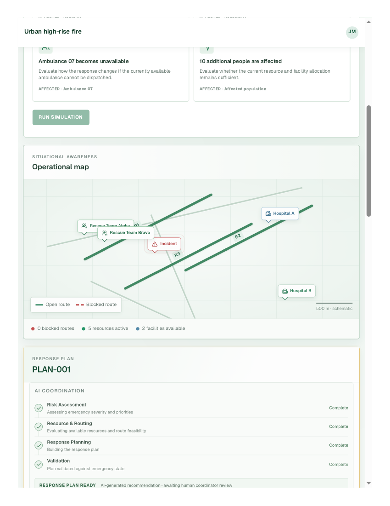
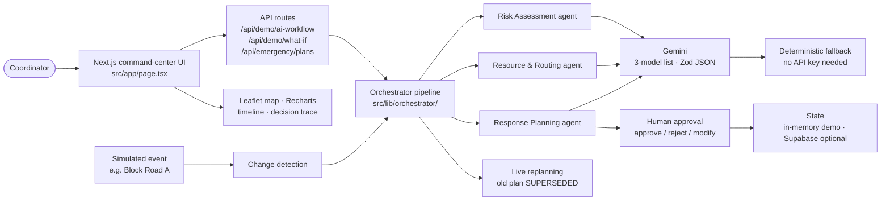
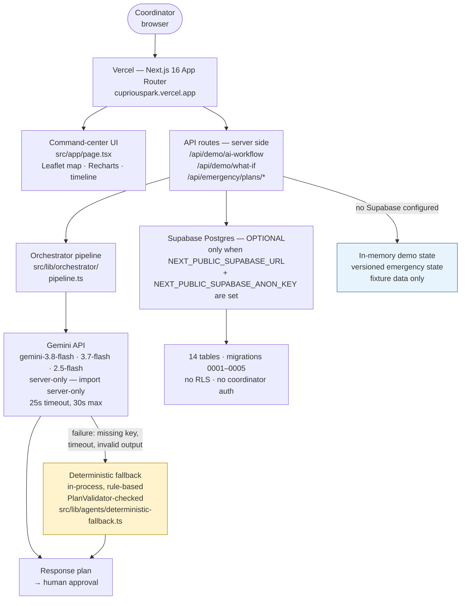

# REACT — Adaptive Emergency Response Intelligence

Built for **CuriousPARC 2026** (national hackathon): a command-center decision-support prototype where AI agents draft emergency response plans, a human approves them, and the system **replans live** when the situation changes.

**Live demo:** https://cupriouspark.vercel.app/ — yes, "cupriouspark" is the real URL spelling.

> **Repo layout, honestly:** this repository is a thin wrapper. It contains only this README and one folder, `react-emergency-coordination/`, which is the entire application and the deploy root. All commands below run inside that folder.

## Screenshots



Command center after starting the demo — operational map (routes R2/R3 open, incident pin, hospitals) and PLAN-001 with all four agent stages Complete. The plan was generated by the deterministic fallback (Gemini unavailable at capture time). Screenshot of the live demo, 20 Nov 2026.

## The demo scenario

Urban high-rise fire, incident **INC-2026-001** — Central district, Building 14, severity CRITICAL, 35 people affected (as shown on the live demo). The command center sees rescue teams and ambulances on a schematic map, hospital bed capacity, and three AI agents standing by until the demo starts.

The demo flow:

1. Agents generate an initial response plan for the fire.
2. A simulated event ("Block Road A") changes the situation.
3. Agents replan in real time — old plan vs new plan, side by side, with an activity timeline.
4. Nothing executes without a human coordinator approving it.

All incident, resource and hospital data in the demo is fictional fixture data, not a real emergency.

## Sequence — from incident to approved plan

```mermaid
sequenceDiagram
    autonumber
    participant C as Coordinator
    participant UI as Command-center UI<br/>(Next.js page)
    participant O as Orchestrator<br/>(pipeline.ts)
    participant R as Risk Assessment agent
    participant RR as Resource & Routing agent
    participant P as Response Planning agent
    participant G as Gemini<br/>(or deterministic fallback)
    participant H as Human approval
    participant S as Supabase<br/>(optional)

    C->>UI: Start demo (INC-2026-001)
    UI->>O: Run agent pipeline
    O->>R: Assess severity, hazards, population impact
    O->>RR: Check resources, facilities, route feasibility
    O->>P: Build response recommendation
    R->>G: Structured JSON request (Zod schema)
    RR->>G: Structured JSON request (Zod schema)
    P->>G: Structured JSON request (Zod schema)
    G-->>P: Draft plan (or fallback output, no API key needed)
    P->>H: Plan submitted for review
    H->>H: Approve / reject / modify
    H->>S: Persist decision + plan lifecycle (if configured)
    H-->>UI: Approved plan shown; timeline updated
    Note over UI,O: Simulated event: "Block Road A"
    UI->>O: Change detected → replan
    O->>P: New plan; previous plan marked SUPERSEDED
    P->>H: New plan submitted for review
    H-->>UI: Old vs new plan, side by side
```

## How it works

- **3 AI agents + orchestrator** — Risk Assessment (`src/lib/agents/risk-assessment`), Resource & Routing (`src/lib/agents/resource-routing`), Response Planning (`src/lib/agents/response-planning`), run by the pipeline in `src/lib/orchestrator/` (`pipeline.ts`, `orchestrator.ts`, `schema.ts`, `persistence.ts`).
- **Human-in-the-loop approval** — plans go through submit → approve / reject / modify → status → execute, in `src/lib/human-approval/`. The live demo states it plainly: *"AI analyzes and recommends. Human coordinators authorize execution."*
- **Dynamic replanning** — `src/lib/replanning/` + `src/lib/change-detection/`; road blocks, hospital overload and similar events trigger fresh plans. A superseded plan is recorded as `SUPERSEDED`.
- **Gemini-powered, with a deterministic fallback** — `src/lib/ai/gemini.ts` (server-only) lists three models — `gemini-3.8-flash`, `gemini-3.7-flash`, `gemini-2.5-flash` — with a 25s default timeout (30s max) and structured JSON validated by Zod schemas. The deterministic fallback (`src/lib/agents/deterministic-fallback.ts`) means the demo runs fully without an API key.
- **What-if simulation** — `src/lib/what-if/` + `/api/demo/what-if`: explore a changed situation without affecting the active emergency (visible on the live demo as "What-if simulation").
- **Maps & charts** — Leaflet operational map (schematic, 500 m scale) and Recharts resource/capacity views.
- **Supabase persistence (optional)** — plan submit/approve/reject/modify/status flows; the deterministic demo runs fully in-memory without it. Migrations `0001`–`0005` in `supabase/migrations/` plus `seed.sql`.

## Data flow



State is modelled as a versioned emergency state (`src/domain/` — incident, resource, facility, route, response-plan, plan-action, agent-run, human-decision, state-change, emergency-state, what-if), so every replan leaves an audit trail in the situation timeline.

## Database — Supabase schema (ERD)

14 tables, defined in `react-emergency-coordination/supabase/migrations/0001`–`0005` (plus `seed.sql`). All primary keys are `TEXT`; every foreign key is `ON DELETE RESTRICT`. There is no row-level security — see [Honest limits](#honest-limits).

```mermaid
erDiagram
    incidents ||--o{ response_plans : "incident_id FK"
    incidents ||--o{ agent_runs : "incident_id FK"
    incidents ||--o{ human_decisions : "incident_id FK"
    incidents ||--|| emergency_states : "incident_id PK and FK"
    response_plans ||--o{ plan_actions : "plan_id FK"
    response_plans ||--o{ human_decisions : "plan_id FK"
    response_plans ||--o{ response_plan_alternatives : "plan_id FK"
    response_plans ||--o{ response_plan_resource_dependencies : "plan_id FK"
    response_plans ||--o{ response_plan_facility_dependencies : "plan_id FK"
    response_plans ||--o{ response_plan_route_dependencies : "plan_id FK"
    resources ||--o{ response_plan_resource_dependencies : "resource_id FK"
    facilities ||--o{ response_plan_facility_dependencies : "facility_id FK"
    routes ||--o{ response_plan_route_dependencies : "route_id FK"
    response_plans ||--o{ human_decisions : "modified_plan_id FK"

    incidents {
        text id PK
        text type "FIRE, MEDICAL, FLOOD, ..."
        text status "ACTIVE, CONTAINED, RESOLVED, CANCELLED"
        text severity "LOW, MODERATE, HIGH, CRITICAL"
        text priority "LOW, NORMAL, HIGH, URGENT"
        int affected_population
        jsonb hazards
        timestamptz reported_at
    }
    resources {
        text id PK
        text type "RESCUE_TEAM, AMBULANCE, FIRE_UNIT, ..."
        text status "AVAILABLE, ASSIGNED, DISPATCHED, ..."
        int capacity
        text current_assignment_id
        jsonb capabilities
    }
    facilities {
        text id PK
        text type "HOSPITAL, SHELTER, MEDICAL_CENTER, ..."
        text status "OPERATIONAL, LIMITED, FULL, ..."
        int total_capacity
        int available_capacity
    }
    routes {
        text id PK
        text status "OPEN, PARTIALLY_BLOCKED, BLOCKED, CLOSED"
        float distance_km
        int estimated_travel_minutes
        text blocked_reason
    }
    response_plans {
        text id PK
        text incident_id FK
        int state_version
        text status "DRAFT, PENDING_APPROVAL, APPROVED, SUPERSEDED, ..."
        text priority
        text summary
        text rationale
        boolean domain_relations_complete
        timestamptz generated_at
    }
    plan_actions {
        text id PK
        text plan_id FK
        int sequence
        text type "DISPATCH_RESOURCE, EVACUATE_AREA, ..."
        text status "PENDING, APPROVED, IN_PROGRESS, ..."
        int capacity_demand
        jsonb resource_ids
        jsonb facility_ids
        jsonb route_ids
    }
    state_changes {
        text id PK
        text entity_type "INCIDENT, RESOURCE, FACILITY, ROUTE, PLAN"
        text entity_id "free text, no FK"
        text change_type "CREATED, STATUS_CHANGED, ..."
        jsonb previous_value
        jsonb new_value
        timestamptz occurred_at
        timestamptz detected_at
    }
    agent_runs {
        text id PK
        text incident_id FK
        text agent_type "RISK_ASSESSMENT, RESOURCE_ROUTING, RESPONSE_PLANNING"
        text status "PENDING, RUNNING, COMPLETED, FAILED, ..."
        int state_version
        int duration_ms
        jsonb output
    }
    human_decisions {
        text id PK
        text plan_id FK
        text incident_id FK
        text decision "APPROVE, REJECT, MODIFY"
        text status "RECORDED, VOIDED"
        text coordinator_id
        text modified_plan_id FK
    }
    emergency_states {
        text incident_id PK
        int state_version
        timestamptz updated_at
    }
    response_plan_alternatives {
        text plan_id FK
        int sequence
        text id
        text summary
        text rationale
    }
    response_plan_resource_dependencies {
        text plan_id FK
        int sequence
        text resource_id FK
    }
    response_plan_facility_dependencies {
        text plan_id FK
        int sequence
        text facility_id FK
    }
    response_plan_route_dependencies {
        text plan_id FK
        int sequence
        text route_id FK
    }
```



Notes on the schema:

- `state_changes` is the audit trail behind the situation timeline — but it has **no incident foreign key**: `entity_id` is free text, so incident history can only be loaded from rows recorded against the incident itself (see [Honest limits](#honest-limits)).
- `response_plans.status` includes `SUPERSEDED` — replanning never deletes the old plan; it marks it superseded and links the new one. There is no dedicated supersedes-plan column (the link is implied by `state_version` + `incident_id`).
- `human_decisions.modified_plan_id` points at the replacement plan when the coordinator chooses MODIFY; it is `NULL` for APPROVE / REJECT (enforced by a CHECK constraint).
- `emergency_states` holds one row per incident with the current `state_version`, bumped by the `increment_emergency_state_version()` function (migration `0002`). Every new plan records the `state_version` it was generated against.
- `plan_actions` stores its targets as JSONB id arrays (`resource_ids`, `facility_ids`, `route_ids`); the `response_plan_*_dependencies` tables (migration `0004`) are the normalised equivalent with real foreign keys, and `domain_relations_complete` (migration `0005`) flags whether a plan's relations were fully recorded.

## Deployment



How each piece reaches the others:

- **Browser → Vercel only.** The coordinator's browser talks to the Next.js app on Vercel; it never calls Gemini or Supabase directly for agent work. The map is a schematic Leaflet view, not a live tile service with real geography.
- **Gemini is server-only.** `src/lib/ai/gemini.ts` starts with `import "server-only"`, and `GEMINI_API_KEY` is a server-only variable (`.env.example` warns it must never use the `NEXT_PUBLIC_` prefix). The key never reaches the browser.
- **Fallback is automatic, not a manual switch.** When a Gemini call fails — missing key, timeout, or invalid output — `src/lib/agents/auto-ai-workflow.ts` parses the failure category and calls `createDeterministicFallbackPlan()` with it. The generated plan is labelled with its source (`DETERMINISTIC FALLBACK`), so the UI can show which engine produced it. The live demo on 20 Nov 2026 ran on the fallback because Gemini was unavailable.
- **Supabase is optional; in-memory is the default.** Without the two `NEXT_PUBLIC_SUPABASE_*` values the demo runs entirely in memory with fixture data. With them, plans, decisions and agent runs persist to the 14 tables above — but there is no row-level security and no coordinator authentication, so the database APIs must not be exposed publicly as-is.

## Tech stack

| Layer | Choice |
|---|---|
| Framework | Next.js 16.3.8 (App Router, pinned) · React 19.2.8 · TypeScript 5 |
| Styling | Tailwind CSS v4 · shadcn/ui (`components.json`) · Base UI React 1.8.0 · lucide-react 1.49.0 |
| AI | `@google/genai` 2.25.0 (Gemini, server-only) · Zod 4.6.5 for structured output |
| Maps & charts | Leaflet 1.9.4 · react-leaflet 5.0.0 · Recharts 3.10.1 |
| Data | Supabase JS 2.117.2 (optional persistence) · 5 SQL migrations |
| Scripts | `dev` · `build` · `start` · `lint` (no test script) |

## Project structure

```text
cupric2026/                          # wrapper repo — README + app folder only
└── react-emergency-coordination/    # the application (deploy root)
    ├── src/
    │   ├── app/                     # page.tsx, layout.tsx, globals.css, api/
    │   │   └── api/                 # demo/ai-workflow, demo/what-if, emergency/plans
    │   ├── components/
    │   │   ├── react/               # command-center components (data/)
    │   │   └── ui/                  # shadcn/ui primitives
    │   ├── domain/                  # incident, resource, facility, route, response-plan,
    │   │                            # plan-action, agent-run, human-decision, state-change,
    │   │                            # emergency-state, what-if
    │   └── lib/
    │       ├── agents/              # risk-assessment, resource-routing, response-planning,
    │       │                        # auto-ai-workflow, deterministic-fallback
    │       ├── ai/                  # gemini.ts, gemini-contract.ts
    │       ├── orchestrator/        # pipeline, orchestrator, schema, persistence, errors
    │       ├── human-approval/  replanning/  change-detection/  simulation/
    │       ├── emergency-engine/  emergency-state/  demo/  what-if/  config/
    │       └── supabase/            # Supabase client/services
    ├── supabase/
    │   ├── migrations/              # 0001_initial_react_schema → 0005_response_plan_relation_completeness
    │   └── seed.sql
    ├── scripts/                     # 16 demo/reliability fixture files (*-fixture.ts/.mjs)
    ├── .env.example
    └── package.json
```

## Getting started

```bash
cd react-emergency-coordination
npm install
npm run dev      # http://localhost:3000
npm run build
npm run lint
```

### Environment variables

```bash
# Live agent calls only — the demo works without it (deterministic fallback)
GEMINI_API_KEY=<redacted>

# Persistence only — the demo runs in-memory without these
NEXT_PUBLIC_SUPABASE_URL=
NEXT_PUBLIC_SUPABASE_ANON_KEY=
```

For persistence, apply the migrations in `supabase/migrations/` in order (`0001` → `0005`), then seed incident, resource, facility, route, agent-run and response-plan data using the existing schemas.

## Honest limits

- **Prototype, not a production system.** Demo data is fictional; the map is schematic, not live geographic data.
- **No coordinator auth or row-level security.** The migrations do not configure RLS policies or coordinator authentication — do not expose the database APIs publicly until access policies appropriate to the deployment are configured (stated in `react-emergency-coordination/README.md`). No live Supabase connection has been verified by this repo.
- **Schema history gaps** (also stated in the app README): `state_changes` has no incident foreign key, so incident history queries can only load rows recorded against the incident itself; replanning marks a previous plan `SUPERSEDED` but has no dedicated supersedes-plan relationship column.
- **No test suite** — `package.json` has `lint` only; `scripts/` holds demo/reliability fixtures, not a test runner. No CI workflow in the repo.
- **Field-team features are out of scope** — no mobile app, push alerts, or field report-back; this is a command-center decision-support prototype.
- **Gemini model availability is not guaranteed here** — the client lists `gemini-3.8-flash`, `gemini-3.7-flash` and `gemini-2.5-flash`; which models answer on the live API was not verified in this repo.

## Judging note

Framed as a **command-center decision-support prototype**: strongest fit for command centers and disaster-management authorities (human approval is the key card); field-team features (mobile, push alerts, field report-back) are out of scope for the prototype.
